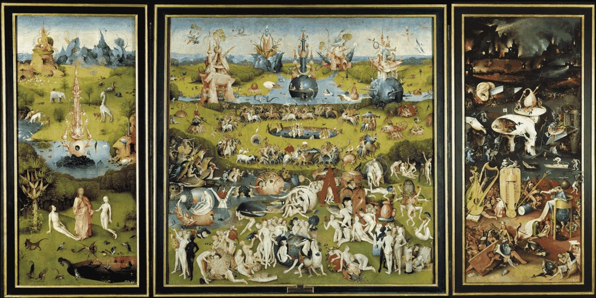

# Bahçenin Kuşu

Hieronymus Bosch'un **Dünyevi Zevkler Bahçesi** tablosunun içinde geçen bir tarayıcı oyunu.
Bir saka kuşuyla tablonun üstünde uçuyorsun, 34 gizli ayrıntıyı arıyorsun, şeytanlardan kaçıyorsun.



## Oyna

👉 **https://bariso72.github.io/bahcenin-kusu/**

Kurulum gerekmez, tarayıcıda açılır (bilgisayarda en iyisi).

- **Fare / ok tuşları:** uç
- **H:** Hikâye turu, tabloyu soldan sağa sahne sahne anlatır (← → Boşluk Esc M)
- **V:** iç görünüm

Tablodaki figürlerin bir kısmı gerçek silüetleriyle kesildi ve tablonun üstünde dolaşıyor:
zürafa, yaban domuzu, ayı, antiloplar, saka kuşu, dev balık, kulaklar, tavşan avcı, patenci.

## Kendi bilgisayarında çalıştırmak

Dosyalar bir sunucudan açılmalı (çift tıklamak yetmez):

```bash
python3 -m http.server 8000
```

Sonra tarayıcıda `http://localhost:8000` aç.

## Dosyalar

| Dosya | Ne işe yarar |
|---|---|
| `index.html` | Oyunun tamamı (three.js ile 3D) |
| `painting.jpg`, `painting_small.jpg` | Tablo (kamu malı) |
| `actors.webp/json` | Dolaşan figürlerin kesilmiş hâlleri ve boşalan yerlerin dolguları |
| `anim.webp/json` | Yerinde hareket eden parçalar |
| `music.mp3` | Müzik |
| `kus2d.html` | Oyunun eski 2D sürümü |
| `tools/` | Figürleri ve sırları hazırlamak için kullanılan Python betikleri |

Not: "Kâşifler Panosu" (skor tablosu) yalnızca Claude'daki sürümde çalışır; burada oyun panosuz açılır.
